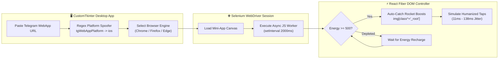

<div align="center">

# 🪙 NotPulse — Telegram Mini-App GUI Auto-Miner

**Cross-Browser Selenium DOM Injector, Platform Spoofer & Energy-Aware Auto-Tapper for Notcoin**

[](https://www.python.org/)
[](https://github.com/TomSchimansky/CustomTkinter)
[](https://www.selenium.dev/)
[](LICENSE)

<p align="center">
  <a href="#-overview">Overview</a> •
  <a href="#-how-it-works">How It Works</a> •
  <a href="#-key-features">Features</a> •
  <a href="#-quick-start--url-extraction">Quick Start</a> •
  <a href="#-راهنمای-فارسی">🇮🇷 راهنمای فارسی</a>
</p>

</div>

---

## 🌐 Overview

**NotPulse (`Notcoin-Miner`)** is a dark-themed desktop automation application built with **CustomTkinter** and **Selenium WebDriver**. It allows users to run the **Notcoin Telegram Mini-App** directly on a desktop browser (Chrome, Firefox, or Edge) by automatically spoofing the Telegram WebApp platform parameter (`tgWebAppPlatform=ios`) and injecting an asynchronous, energy-aware React DOM auto-clicker.

---

## 🏗️ How It Works



---

## ✨ Key Features

- **📱 Automatic Platform Spoofing (`tgWebAppPlatform=ios`)**: Telegram Mini-Apps block desktop browsers by default. NotPulse intercepts the launch URL via Regex and rewrites the platform identifier to `ios` on the fly.
- **🔋 Smart Energy & Recharge Management**: Continuously reads `div[class^="_scoreCurrent"]` from the DOM, pauses tapping when energy runs low, and resumes automatically once energy regenerates above `powerLimitForAutotap` (`500`).
- **🚀 Automatic Rocket Boost Catcher**: Scans the React Fiber tree for active rocket boost elements (`img[class^="_root"]`) and invokes their native `onClick()` handler immediately.
- **⏱️ Humanized Tap Jitter**: Uses randomized `Promise` delays (`Math.floor(Math.random() * 127) + 11` ms) between taps to mimic organic touch intervals.
- **🌐 Multi-Engine Support**: Switch seamlessly between **Google Chrome**, **Mozilla Firefox**, and **Microsoft Edge** from the GUI dropdown.

---

## 🚀 Quick Start & URL Extraction

### Step 1: Install Dependencies
```bash
git clone https://github.com/AdamBarfii/Notcoin-Miner.git
cd Notcoin-Miner
pip install -r requirements.txt
```

### Step 2: Extract Your Telegram WebApp Session URL
1. Open **[Telegram Web](https://web.telegram.org)** in your browser and navigate to the **Notcoin** bot.
2. Press `F12` (or `Ctrl+Shift+I`) to open **Developer Tools** and switch to the **Network** tab.
3. Click **Play / Let's Go** inside the bot.
4. In the Network request list, locate the **`event`** (or WebApp iframe) entry, right-click the **`u`** / WebApp URL parameter (`https://clicker.joincommunity.xyz/clicker#tgWebAppData=...`), and select **Copy Value**.

### Step 3: Launch NotPulse GUI
```bash
python "NotcoinPA(@NotcoinPA).py"
```
1. Paste your copied WebApp URL into the input box.
2. Select your installed browser (`Chrome`, `Firefox`, or `Edge`).
3. Click **Open Browser** — the platform spoofer and auto-miner will start automatically!

---

## ⚙️ Injected Engine Parameters

| Parameter | Default | Description |
| :--- | :--- | :--- |
| `powerLimitForAutotap` | `500` | Minimum recharged energy threshold required before resuming burst taps. |
| `countclicks` | `34` | Number of sequential taps per cycle. |
| `Tap Interval Jitter` | `11ms – 138ms` | Randomized delay between individual taps inside a burst. |
| `Loop Interval` | `2000ms` | Master evaluation interval for energy checks and rocket detection. |

---
---

<div dir="rtl">

## 🇮🇷 راهنمای فارسی

**نرم‌افزار NotPulse (`Notcoin-Miner`)** یک برنامه دسکتاپ با رابط گرافیکی مدرن (**CustomTkinter Dark Mode**) و موتور اتوماسیون **Selenium** برای اجرای خودکار مینی‌اپ تلگرام (نات‌کوین) روی کامپیوتر است.

### ✨ قابلیت‌های کلیدی:
1. **دور زدن محدودیت دسکتاپ (`tgWebAppPlatform=ios`):** لینک وب‌اپ تلگرام را به صورت خودکار ویرایش کرده و پلتفرم را به `ios` تغییر می‌دهد تا بازی بدون خطای موبایل روی کامپیوتر باز شود.
2. **مدیریت هوشمند انرژی (Energy-Aware):** مقدار انرژی فعلی را لحظه‌به‌لحظه از صفحه می‌خواند؛ هنگام اتمام انرژی صبر می‌کند تا شارژ به بالای `500` برسد و سپس دوباره کلیک را شروع می‌کند.
3. **دریافت خودکار راکت (Rocket Boost):** به محض ظاهر شدن راکت در صفحه، رویداد کلیک آن را در ساختار React فراخوانی و فعال می‌کند.
4. **پشتیبانی از ۳ مرورگر:** امکان انتخاب بین مرورگرهای **Chrome**، **Firefox** و **Edge** از داخل محیط گرافیکی برنامه.

### ⚡ نحوه استخراج لینک و اجرا:
۱. ابتدا پیش‌نیازها را نصب کنید:
```bash
pip install -r requirements.txt
```
۲. وارد نسخه وب تلگرام (`web.telegram.org`) شوید، کلید `F12` را بزنید و به تب **Network** بروید.
۳. روی دکمه شروع بازی کلیک کنید، از لیست درخواست‌ها گزینه `event` یا لینک وب‌اپ را پیدا کرده و مقدار لینک (`u`) را کپی کنید.
۴. برنامه را اجرا کنید، لینک را وارد کرده و دکمه **Open Browser** را بزنید:
```bash
python "NotcoinPA(@NotcoinPA).py"
```

</div>

---

## 📄 License

Distributed under the **MIT License**. See [`LICENSE`](LICENSE) for details.
